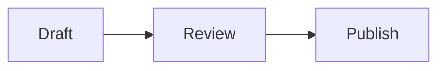

# Import an agent-created document into Mitosu

Use the Mitosu CLI to create a Note from the finished document. Apply this skill when the user requests an export to Mitosu; creating a Markdown document alone does not trigger an import. Use the document already created in the conversation or workspace. Ask which document only if the intended source is ambiguous.

## Prepare the document

- Export the full document, preserving its prose, headings, lists, links, tables, code, equations, and visualization source. Do not substitute a summary or include surrounding conversation or an outer Markdown code fence.
- Import into **Root** by default, omitting `--project`. If the user names a project, pass its exact name or UUID with `--project`. An unknown project is an error; do not silently fall back to Root or create a project.
- Prefer the user's requested title, otherwise the document's first H1, then its filename without `.md`, then a concise title derived from its contents. Pass it with `--title` so Mitosu records a manual title. Respect a request to let Mitosu choose the title by omitting that option.
- Use an existing UTF-8 `.md` file when available. Use stdin for a document that exists only in the conversation, or when the user requests it. Never pass rendered HTML, rich text, or a JSON-escaped Markdown string as the document.
- Keep the original file unchanged. If image paths need adjustment, prepare an export copy or adjusted stdin payload.

## Preserve inline visuals

Treat visualization source as document content, including backslashes, backticks, embedded data, comments, and sizing directives. Keep existing native blocks editable; do not replace them with screenshots during a routine export.

| Content | Export handling |
| --- | --- |
| Mermaid | Preserve the `mermaid` fenced block and its source. For a newly authored block, use Mermaid syntax, such as `flowchart LR` followed by `A --> B`. |
| seqdiag | Preserve the `seqdiag` fenced block. Its source uses WebSequenceDiagrams-style syntax, such as `Alice->Bob: Request` and `Bob-->Alice: Response`; do not substitute Mermaid's `sequenceDiagram` grammar. |
| DOT / Graphviz / dotgraph | Preserve the complete DOT source and existing fence label. Before authoring a native block, verify the target build's documented language label and options; do not assume `dot`, `graphviz`, and `dotgraph` are interchangeable. |
| D3 | Preserve the visualization source, data, and existing embedding format. Before authoring a native block, verify the target build's fence label, entry point, available D3 version, and rendering contract. A generic JavaScript or HTML fence does not establish D3 rendering support. |
| Inline images | Preserve alt text and supported sizing markup. Package referenced image files with the imported Note as described below. |

Use native `mermaid` and `seqdiag` blocks for those diagram types. Preserve supplied DOT/Graphviz and D3 blocks without claiming they have been visually verified. Verify native rendering support using the installed Mitosu version's documentation or observed behavior. If a requested new DOT or D3 visual has no verified native renderer, use an available renderer to produce a static inline image and retain its source in a labeled code block. If interactivity is required or no suitable renderer is available, clarify that limitation before changing the requested output. TikZ is outside this skill's scope.

For native blocks, leave image generation and caching to Mitosu. Do not manufacture cached renderer filenames. Successful CLI import verifies storage, not visual rendering.

### Image attachments

The CLI imports Markdown only; it does **not** copy sibling images. Mitosu resolves inline image paths relative to the Note directory.

1. Before importing, identify the document's referenced image assets and verify they are available. Resolve relative paths against the source document's directory or the known artifact directory for conversation-only content. Do not guess their base directory or copy entire directories.
2. Allocate simple, collision-free relative names, such as `assets/architecture.png`. Prepare a mapping from each source asset to its destination. Rewrite only those image destinations in the export copy/payload, preserving alt text and sizing markup. Apply the same treatment to supported `` references. Do not rewrite example image syntax inside code blocks.
3. After the CLI returns the new Note's directory, copy only the mapped assets beneath that directory, creating their parent directories. Copy bytes without regenerating images. Ensure every destination remains within the returned Note directory; do not overwrite `index.md`, metadata, or existing unrelated files.
4. Verify that each rewritten image reference resolves to its copied asset. This applies to both file and stdin imports. If copying fails, report that the Note exists but its attachments are incomplete; repair that Note's attachments rather than importing it again.

Do not assume remote image URLs, `data:` URIs, absolute paths, or temporary source paths will render or remain portable. For a self-contained export, use available local image assets or retrieve the document's referenced images when authorized and accessible. If a required asset is unavailable, resolve the gap before importing or get the user's agreement to omit it.

## Locate the CLI

Prefer a working `mitosu` on `PATH`. On macOS, the bundled CLI is normally:

```sh
mitosu_cli='/Applications/Mitosu.app/Contents/Helpers/mitosu'
"$mitosu_cli" import --help
```

Use the helper's `import --help` to verify its interface, including for a different app installation path. `Contents/MacOS/Mitosu` is the GUI executable. The macOS command is `mitosu import <file.md>` or `mitosu import -`; `notes` is not an extra subcommand.

If no working CLI is available, report the problem and ask for its location or installation. Do not build the app, modify `PATH`, or write Note metadata manually as an automatic fallback.

## Import a file or stdin

Use `--json` to obtain the created Note's identity and directory. Import one document per invocation. Pass paths, titles, and project names as separate, safely quoted arguments. Use an absolute file path so a leading hyphen cannot become an option.

File example:

```sh
"$mitosu_cli" import '/absolute/path/document.md' --title 'Document title' --json
```

Stdin example, including a native diagram:

````sh
cat <<'MITOSU_DOCUMENT_EOF' | "$mitosu_cli" import - --title 'Document title' --json
# Document title

The complete document goes here, with its original Markdown.


MITOSU_DOCUMENT_EOF
````

Choose a quoted heredoc delimiter that does not occur as a complete line in the document. Quoting protects Markdown, dollar signs, backticks, and diagram backslashes from shell expansion. For a file sent through stdin, use input redirection instead:

```sh
"$mitosu_cli" import - --title 'Document title' --json < '/absolute/path/document.md'
```

Add `--project 'Exact project name or UUID'` only when requested. Leave the CLI's normal data directory in effect unless the user explicitly selects another store; the macOS default is `~/Documents/Mitosu`. The CLI also supports `--root-data-dir` for an explicitly selected store or an isolated test fixture.

## Verify and report

- Require a successful exit and parse the JSON fields `id`, `title`, `slug`, and `path`. `projectId` is optional and is omitted for Root by the macOS CLI. `path` is the Note **directory**, and the Markdown file is `path/index.md`.
- Read the new `index.md` and confirm the exported body is intact after Mitosu's generated frontmatter. Check diagram blocks and attachment references; copying files alone does not prove the app rendered them.
- Import creates a new Note with a new ID every time. It does not update a previous export. Do not repeat a successful import to verify it, and do not blindly retry after a timeout or uncertain result. Check whether a Note was created first. A request to replace an existing Note needs an update workflow or agreement to create a new Note.
- Report the imported title, destination, and a clickable link to the returned `index.md` when available. Mention any incomplete assets or unverified rendering that matters. Do not claim cloud synchronization, app display, or interactive behavior unless independently observed.
